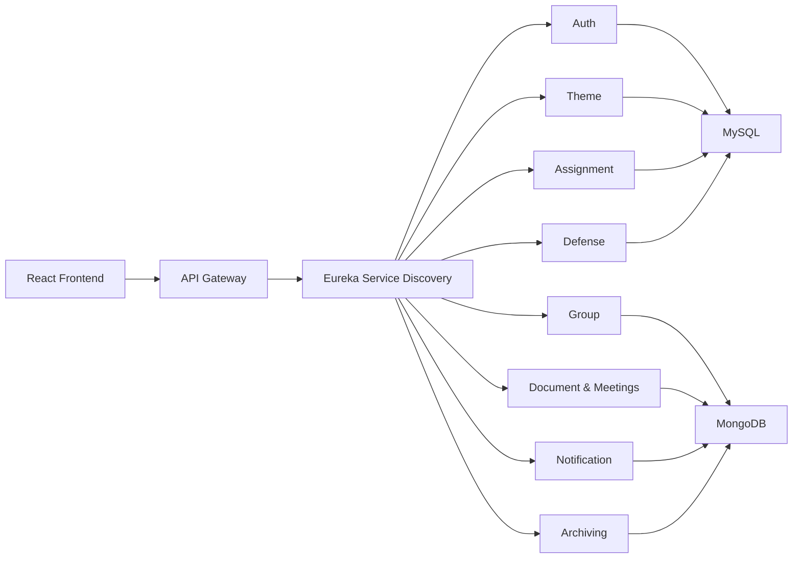

# Student Project Management Platform

CodeGrade: A web platform that manages the full lifecycle of end-of-studies projects: from proposing project themes, to forming student groups, assigning themes, following progress, and scheduling the final defense.

Teachers and partner companies propose project ideas and internship offers. Students form groups and are assigned a theme for their academic year and specialty. Supervisors follow the progress through submitted documents and meetings, and the administration plans the defenses.

> Multi-disciplinary university project, built with a **microservices architecture**.

## Features

### Roles

| Role | What they can do |
|---|---|
| **Admin** | Manage users, academic years, departments, specialties, rooms and periods; validate or reject themes and companies; assign themes to groups; schedule defenses; archive data; export to Excel/PDF |
| **Teacher** | Propose themes, supervise groups, review submitted documents (validate, refuse with a reason, add notes), organize meetings with groups, validate a group's defense |
| **Student** | Create a group or accept an invitation, choose themes, submit PDF documents, see meetings and defense details |
| **Company** | Register (validated by the admin), propose project themes and internship offers |

### Main capabilities

- **Theme management:** create, validate/reject (with a reason), reserve, search, archive, import from PDF, export to PDF
- **Groups:** create groups with members, send/accept/refuse invitations, group parameters per year (min/max members), group average calculation
- **Theme assignment:** manual assignment or random assignment according to the maximum number of groups a theme can supervise
- **Document tracking:** students submit PDF files, supervisors validate, refuse or annotate them
- **Meetings:** supervisors plan appointments with their groups
- **Defense planning:** rooms, time slots, supervisors and jury members
- **Notifications:** invitations, theme status changes, company requests, and more
- **Archiving:** by academic year, theme, group, assignment, defense
- **Security:** JWT authentication (access + refresh tokens), role verification, password reset by email

## 🏗 Architecture

Each major feature runs as an independent microservice. Services register with **Eureka** for dynamic service discovery, and an **API Gateway** is the single entry point for client requests.

Benefits: independent scalability, clear separation of responsibilities, and the freedom to use the best technology for each service.

## 🧩 Microservices

| Service | Stack | Database | Responsibilities |
|---|---|---|---|
| **Authentication** | Django REST | MySQL | Users (students, teachers, admins, companies), JWT login/refresh/logout, password reset, academic years, departments, specialties, rooms, periods, group parameters, company validation, bulk import, Excel/PDF export |
| **Theme** | Django REST | MySQL | Theme CRUD, validation/refusal, reservation, search, teacher assignment, PDF import/export, archiving |
| **Group** | Node.js | MongoDB | Group creation, members, invitations, group averages, filters by year and specialty |
| **Assignment** | Django REST | MySQL | Manual and random theme assignment, supervisor lookup, archiving |
| **Document & Meetings** | Node.js | MongoDB | PDF submission, status review (pending / validated / refused), notes |
| **Defense** | Django REST | MySQL | Defense scheduling, jury and room availability checks, filters, archiving |
| **Notification** | Express (Node.js) | MongoDB | User and admin notifications, unread list, mark as read |
| **Archiving** | Node.js | MongoDB | Archiving of years, group parameters, periods, themes, assignments and defenses |

## Tech Stack

| Category | Technologies |
|---|---|
| Frontend | React |
| Backend | Python (Django REST Framework), Node.js (Express) |
| Databases | MySQL, MongoDB |
| Infrastructure | Eureka, API Gateway, JWT, Docker |

## My Role

**Ayet Halima Derki:** Main UI/UX Designer, Main Frontend Developer, Participated in Backend

## License

This project was developed for educational purposes.
